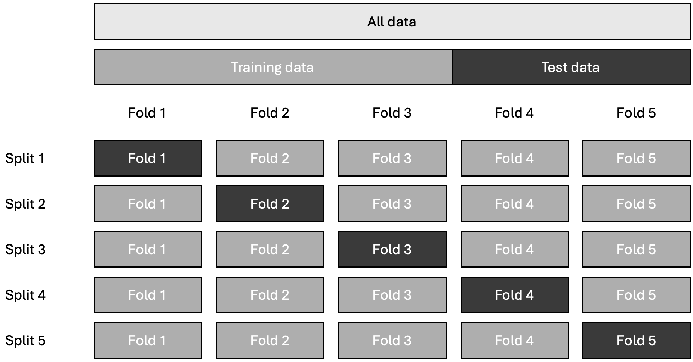
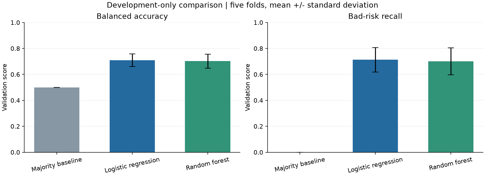
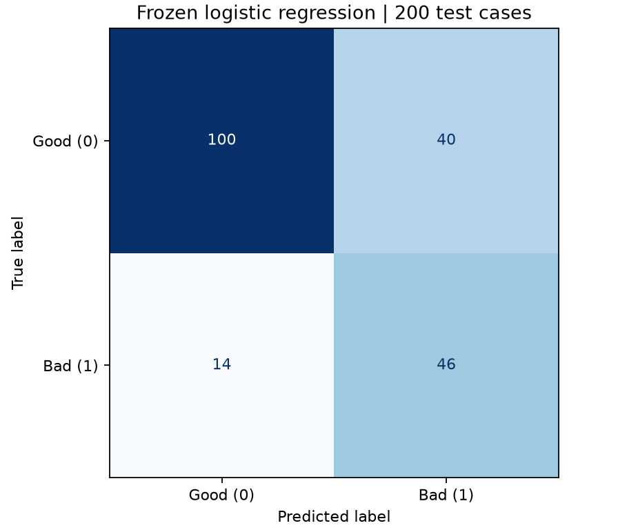

# Credit Scoring Project Report

Introduction to AI in Business and Management

Team: Jan Jurczyk, Nicolai Hönnige, Philipp Pehlemann and Zofia Wiśniewska Presentation date: 3 November 2026 Version date: 1 November 2026

### Section responsibilities

| Author | Sections |
| --- | --- |
| Jan Jurczyk | 1 Business problem; 2 Existing solutions and literature |
| Nicolai Hönnige | 3 Generative AI experiment; 4.1 to 4.3 Data and method |
| Philipp Pehlemann | 4.4 Results and interpretation; 5 Costs and benefits |
| Zofia Wiśniewska | 6 Risks and limitations; 7 Lessons and next steps |

### Research question

How well can a simple machine learning model classify credit risk using seven applicant and loan characteristics?

### Usage of AI

We used generative AI to support coding, debugging, project documentation, and the drafting and editing of parts of this report and presentation. The team reviewed and adapted AI-generated material and remains responsible for the submitted work. Model performance was calculated using our Python evaluation pipeline. We also used the OpenAI API in a documented prompt-comparison experiment and for optional explanations in the Streamlit demo. These explanations do not determine the model’s predictions and should not be treated as lending advice.

## 1 Business problem

*Responsible author: Jan Jurczyk*

### 1.1 Credit risk in banking

When a bank provides a loan, it takes the risk that the borrower may not repay it. Before approving an application, the bank must assess the customer's creditworthiness using information such as their financial situation, credit history, and loan characteristics.

Credit risk assessment helps banks reduce potential losses while continuing to provide loans to reliable customers. The European Banking Authority (2020) sets out guidelines for assessing borrowers' creditworthiness.

### 1.2 The cost of incorrect decisions

Banks face two main types of errors when assessing loan applications:

False approval: A high-risk applicant is classified as low-risk. The bank may approve the loan and face financial losses if the borrower fails to repay.

False rejection: A low-risk applicant is classified as high-risk. The bank may reject a customer who would have repaid the loan, losing potential revenue.

These errors have different financial consequences.

The German Credit dataset used in our project includes a historical assumption that approving a bad-risk applicant is five times more costly than rejecting a good-risk applicant (Hofmann, 1994). This is an illustrative cost ratio, not an estimate of actual bank losses.

Therefore, banks need to consider both prediction accuracy and the consequences of incorrect classifications.

### 1.3 How AI can help

Machine learning can analyse historical credit data and identify patterns linked to credit risk. This can help banks assess applicants more consistently and support decisions about which applications may require further review.

However, AI models can make mistakes, and their predictions depend on the data used to train them. They should support credit assessment rather than automatically replace it.

Our project examined whether a simple machine learning model using seven applicant and loan characteristics could classify credit risk. We compared the models with a basic prediction approach and evaluated their performance and errors.

The goal is to test whether machine learning provides useful information for credit risk assessment, not to create a system that makes real lending decisions.

## 2 Existing solutions and literature

*Responsible author: Jan Jurczyk*

### 2.1 Traditional credit-scoring methods

Banks use different methods to assess the risk of loan applicants. These include manual credit assessment, rule-based systems, and statistical credit-scoring models.

Manual assessment: Credit analysts review information such as income, existing debt, and repayment history to evaluate an applicant.

Rule-based systems: Applications are assessed against predefined conditions, such as income requirements or debt limits.

Statistical scoring: Models use historical data to estimate credit risk based on applicant characteristics.

Hand and Henley (1997) review statistical classification methods in consumer credit scoring. Their research shows how statistical approaches can be used to classify applicants into good and bad credit-risk categories.

One established statistical method is logistic regression, which estimates the probability of a binary outcome, such as a good or bad credit-risk classification.

### 2.2 Machine learning in credit scoring

Machine learning offers alternative methods for identifying patterns in historical credit data. Unlike simple linear models, some machine learning algorithms can capture more complex relationships between applicant characteristics.

Lessmann et al. (2015) compared 41 classification algorithms across eight credit-scoring datasets. They found that several advanced methods achieved higher predictive accuracy than logistic regression. However, the study also considered whether improvements in prediction performance translate into economic value.

Machine learning models also have limitations. Some methods are more difficult to interpret, which matters when their outputs may influence lending decisions.

Bussmann et al. (2021) examined explainable machine learning in credit risk management, showing how model explanations can be incorporated into risk analysis.

### 2.3 Connection to our project

Based on this literature, our project compares three approaches:

Majority-class baseline: A simple reference that always predicts the most common risk category.

Logistic regression: A statistical classification model used as an interpretable reference.

Random forest: A machine learning algorithm combining multiple decision trees to identify more complex patterns.

We evaluated whether these models could classify credit risk using only seven selected applicant and loan characteristics from the German Credit dataset.

The objective was not to prove that machine learning is always better. Instead, we compared the models under the same conditions and assessed their performance, prediction errors and potential usefulness for credit risk assessment.

## 3 Generative AI experiment

*Responsible author: Nicolai Hönnige*

We tested whether generative AI could explain credit-scoring results clearly to a bank manager without a machine-learning background. The aim was to communicate the findings and their limitations, rather than ask the language model to make credit decisions.

The experiment used the OpenAI Responses API with the fixed model snapshot GPT-5.4 mini dated 17 March 2026 (OpenAI, n.d.-a, n.d.-c). We compared two prompts. The simple prompt asked the model to explain the results to a bank manager. The structured prompt additionally requested both error types, the relevant class totals and a distinction between overall accuracy and the detection of bad risks. It also instructed the model not to invent individual causes, present scores as calibrated default probabilities, describe illustrative costs as actual savings, or recommend lending decisions.

An initial pilot generated three responses per prompt using our actual project results. After reviewing this small sample, we designed a separate extension covering three scenarios, with five responses per prompt in each scenario. This produced 30 additional responses. The original six responses were retained separately and were not pooled into the expanded comparison.

The first scenario used our actual test results: 46 of 60 bad risks detected and 40 of 140 good risks incorrectly flagged. The other two scenarios used explicitly synthetic counts. One combined 90% accuracy with poor detection of bad risks: only 4 of 20 were detected. The other detected 90 of 100 bad risks but incorrectly flagged 55 of 100 good risks. These scenarios tested whether the explanations recognised different error trade-offs. They were not additional results of our credit model.

Both prompts received identical information within each scenario and the same instruction to write 120–180 words. We kept the model settings unchanged: temperature 0.7, reasoning effort set to none and a maximum of 800 output tokens. Each request was separate. The order of scenario and repetition pairs was shuffled, as was the prompt order within each pair. The protocol, inputs, and assessment criteria were recorded in Git before generation. All 30 requests were completed, and no response was discarded or replaced. Only aggregate facts were supplied to the API.

Five pass/fail criteria were defined before the expanded run: numerical accuracy, complete class totals and corresponding counts, explanation of both error types, avoidance of unsupported claims, and compliance with the word limit. Word counts were checked automatically. The remaining criteria were assessed through an AI-assisted reading of every response against its input, with excerpts and reasons recorded. This assessment was neither independent nor blinded. Nicolai Hönnige reviewed the 30 responses and the AI-assisted assessment. No corrections were reported. Combining automated checks with human judgement is recommended when evaluating generative AI outputs (OpenAI, n.d.-b).

No numerical error was identified in either prompt’s 15 responses, and both error types were explained throughout. The simple prompt included complete class totals and corresponding counts in 10 of 15 responses, compared with 15 of 15 for the structured prompt. Five simple responses were flagged for statements extending beyond the evidence. Examples included describing the model as useful for practical decision support or claiming that missing a bad borrower is usually the costliest mistake. The latter generalised our illustrative cost assumption beyond what the supplied information established.

No clear failure of the unsupported-claims criterion was identified in the structured responses. However, both variants sometimes described classification outcomes as actual approvals or rejections. Some structured responses also called the synthetic scenarios historical examples, although they usually clarified that the counts were invented. These wording issues remain relevant even when an answer passes the main criteria.

The simple prompt met the word limit in all 15 responses. The structured prompt met it in 12, with three responses containing 183, 192 and 183 words. More detailed instructions therefore produced more complete numerical context in this comparison, but did not guarantee compliance with every constraint.

The findings remain exploratory. The extension was designed after inspecting the pilot and covered only three selected scenarios using one model. Repeated responses are not equivalent to independent real-world tasks. In addition, the structured prompt explicitly requested information included in the assessment criteria, so the comparison partly measures instruction compliance rather than overall writing quality. It does not demonstrate general reliability or statistical superiority.

Recorded responses from all three scenarios are available in the Streamlit demo, with synthetic examples clearly labelled. The live aggregate explanation uses the actual project results. A separate feature explains a submitted fictional profile using calculated contributions from the saved logistic-regression model. After an explicit button click, the seven fictional inputs, predicted class and contributions are sent to OpenAI. These contributions describe the fitted model’s calculation relative to a development-data reference; they do not establish causal effects or future default probabilities. This feature was outside the prompt comparison and does not change the prediction.

## 4 Empirical analysis

*Responsible author: Nicolai Hönnige for 4.1 to 4.3; Philipp Pehlemann for 4.4*

### 4.1 Goal and assumptions

The empirical analysis addressed the following question: How well can a simple machine-learning model classify credit risk using seven inputs?

Our aim was to build a manageable teaching example that could be demonstrated through a small application. We therefore selected a limited set of inputs and compared two machine-learning methods with a simple reference model. The seven-input selection was a practical design choice for the project, not the result of a systematic search for the best feature combination.

The model predicts the dataset’s historical Good and Bad risk labels. These labels do not document a specific future-default period, such as default within twelve months. The model’s output should therefore not be interpreted as a validated probability of future default.

The evaluation considered both types of classification error: a bad risk classified as good and a good risk classified as bad. The dataset documentation assigns the former five times the cost of the latter (Hofmann, 1994). We used this ratio for an illustrative comparison, not as evidence of actual financial losses or savings.

### 4.2 Dataset and preprocessing

We used the Statlog German Credit dataset from the UCI Machine Learning Repository (Hofmann, 1994). It contains 1,000 cases, with 700 labelled Good risk and 300 labelled Bad risk. The original dataset provides 20 input variables.

Our model used seven: credit amount, loan duration, loan purpose, checking account status, savings status, employment duration and credit history. These cover the loan request and selected aspects of the applicant’s recorded financial background. Credit amounts remain in the dataset’s historical currency, Deutsche Mark, rather than being presented as euros.

The original labels were converted to 0 for Good risk and 1 for Bad risk. A fixed, stratified split reserved 800 cases for development and 200 for final testing, preserving the 70:30 class distribution in both partitions. Subsequent exploratory analysis used the development partition only.

Checks of the selected development inputs found no missing values, unexpected category codes or duplicate seven-input profiles. However, some categories were uncommon, and some combined meanings. For example, the savings category “unknown/no savings account” cannot be treated as a precise measurement of savings.

Categorical inputs were converted using one-hot encoding. Credit amount and duration were standardised for logistic regression and retained in their original numeric scale for the random forest. Preprocessing and classification were combined in a pipeline, so transformations were fitted only on the training portion of each validation fold. This helps prevent information from validation cases influencing model fitting (Scikit-learn developers, n.d.-b).

### 4.3 Method and experimental setup

We compared an Always-Good baseline, logistic regression and a random forest. The baseline predicts Good risk for every case. It provides an important reference because the majority class already accounts for 70% of the dataset. The baseline uses the most-frequent-class strategy (Scikit-learn developers, n.d.-d).

Logistic regression combines weighted inputs into a classification score. The random forest combines predictions from multiple decision trees and can represent more complex relationships. These methods are implemented in scikit-learn (Scikit-learn developers, n.d.-e, n.d.-f). Both machine-learning models used balanced class weights. The random forest contained 300 trees with a minimum of five samples per leaf. We used fixed settings rather than conducting a parameter search.

The models were compared through five-fold stratified cross-validation on the 800 development cases. Each fold used 640 cases for training and 160 for validation. All models received the same folds, and preprocessing was fitted separately within each training fold. This allowed comparison without using the reserved final test set for model selection (Scikit-learn developers, n.d.-c).

Balanced accuracy was the primary selection metric because it gives equal weight to the detection rates of the two classes (Scikit-learn developers, n.d.-a). We also recorded overall accuracy, bad-risk precision, recall, F1, ROC-AUC and illustrative error cost. The cost calculation assigned five units to a bad risk predicted as good, one unit to a good risk predicted as bad and zero to a correct classification.

Logistic regression was selected because it achieved slightly higher mean validation balanced accuracy and lower illustrative cost than the random forest, while remaining simpler to explain. The differences were small and do not establish statistical superiority.

The selected model and decision threshold of 0.5 were fixed before the final test. The model was then fitted on all 800 development cases and evaluated once on the 200 reserved cases. No model or threshold changes were made in response to those test results.

The same saved pipeline is used in the Streamlit application. Users enter seven values for a fictional profile and receive a predicted risk class. The application does not retrain the model or make a lending decision. Its optional generative-AI explanations are separate from the classifier and do not alter its output.

### 4.4 Results and interpretation

*Responsible author: Philipp Pehlemann*

To answer our research question, we compared three approaches that differ in complexity. Each of them answers a different important question.

- Always-good baseline: A deliberately naive reference that predicts “good risk” for every applicant. Because 70% of the cases in our data are good risks (class imbalance), it is already right 70% of the time without detecting a single bad risk. Any real model must prove that it adds something beyond this.

- Logistic regression: A classic statistical model that combines seven inputs into a single risk score. A case is classified as “bad risk” if this score reaches a threshold, which is 0.5 in our setup. The model is easy to interpret, which is one reason why it is widely used in credit scoring (Hand & Henley, 1997).

- Random forest: A machine learning model built from many decision trees that vote together. It can capture more complex patterns, but it is harder to explain and requires more computational effort.

All three models used the same seven inputs and were evaluated under identical conditions (see Section 4.3 for the setup).

A model evaluated on the same cases it learned from may appear better than it is because it can memorise patterns in those cases (overfitting). To avoid this, we divided the 1,000 cases into an 800-case development partition and a separate 200-case test partition. Within development, training cases were used to learn patterns and validation cases to compare candidates. We applied stratified five-fold cross-validation: in each round, the model was trained on 640 cases and validated on the remaining 160 (Figure 1). Every development case was used for validation exactly once. The 200 test cases were held back until the model and threshold had been selected. We then evaluated the selected model once without changing it afterwards. This separation supports a credible final assessment (Scikit-learn developers, n.d.-b, n.d.-c).

**Figure 1. Five-fold cross-validation within development data. Schematic not to scale: 800 development cases and 200 separate test cases.**

With the models built and the data prepared, we next need to define how their predictions can be right or wrong. For each case, a model predicts either “good risk” or “bad risk”. Compared with the historical label, this leads to four possible outcomes (see table 1). We treat “bad risk” as the case we want to find.

**Table 1. Confusion matrix**

|  | Predicted good risk | Predicted bad risk |
| --- | --- | --- |
| Actually good risk | Correct Good classification | False rejection  (good applicant flagged as bad) |
| Actually bad risk | False approval (bad applicant passes as good) | Correct Bad classification |

Our application does not make real lending decisions, so “approval” and “rejection” describe hypothetical consequences of classification errors. As discussed in Section 1, a false approval could expose a bank to a loss if the borrower defaults, while a false rejection could mean lost interest margin or a lost customer. The relative costs depend on the lending context. The dataset illustrates this with a cost matrix in which a false approval counts five times as much as a false rejection (Hofmann, 1994). This is an assumed ratio, not a measured loss figure. False rejections also matter because they can cost business and disadvantage applicants.

Because the two errors have different consequences, a single number such as the share of correct predictions cannot describe the model’s performance fully. We therefore evaluated the models with several measures (Table 2).

**Table 2. Evaluation measures**

| Measure | Explanation |
| --- | --- |
| Accuracy | Share of all cases classified correctly; can be misleading when one class dominates. |
| Bad-risk recall | Of all truly bad cases, how many did the model find? |
| Bad-risk precision | Of all cases flagged as bad, how many really were bad? |
| Balanced accuracy | Average of recall for good and for bad cases. Main selection metric, because it treats both classes equally |
| ROC-AUC | How well the model ranks bad cases above good ones, regardless of threshold (0.5 = chance, 1.0 = perfect) |
| Cost per case | Average error cost under the assumed 5:1 weighting. |

Table 3 shows the validation results on the 800 development cases. Logistic regression and random forest perform almost identically, and both clearly beat the baseline in balanced accuracy and bad-risk recall. We selected logistic regression because it had the highest balanced accuracy, a slightly lower cost per case, and a simpler structure. However, the difference is small compared with the variation between the folds (a standard deviation of about 0.05 in balanced accuracy), so we do not claim that it is generally the better model. Figure 2 shows the validation comparison.

**Table 3. Validation means on 800 development cases across five folds**

| Model | Accuracy | Balanced accuracy | Bad-risk recall | ROC-AUC | Cost per case\* |
| --- | --- | --- | --- | --- | --- |
| Always-good baseline | 70.0% | 50.0% | 0.0% | 0.500 | 1.50 |
| Logistic regression | 70.8% | 70.9% | 71.3% | 0.766 | 0.64 |
| Random forest | 70.3% | 70.2% | 70.0% | 0.778 | 0.66 |

\*Assumed cost units, not euros.

After this selection, the model was fitted on all 800 development cases and evaluated once on the 200 test cases. It reached an accuracy of 73.0%, a balanced accuracy of 74.0% and a ROC-AUC of 0.810. The gain of three percentage points in accuracy over the baseline looks modest, but the error structure is completely different (Table 4). The model found 46 of 60 bad risks (recall 76.7%), and missed 14 of them (false approvals), whereas the baseline found none. The price is 40 wrongly flagged good applicants (28.6% of all good cases). Moreover, of the 86 cases flagged as bad, only 46 truly were, which gives a precision of 53.5%. Figure 3 shows the final test confusion matrix.

**Table 4. Final test confusion matrix (n = 200)**

|  | Predicted good risk | Predicted bad risk |
| --- | --- | --- |
| Actually good risk | 100 correct | 40 false rejections |
| Actually bad risk | 14 false approvals | 46 detected |

The results show that a simple model with seven inputs can distinguish the historical risk classes better than the naive baseline on balanced accuracy and bad-risk detection. The model detects about three of four bad risks, yet roughly every second flagged case is a false alarm. This is the central trade-off in our results: detecting bad risks also comes with wrongly flagging good cases. The 0.5 threshold determines this balance; an operational threshold would require a bank’s own costs and validation.

**Figure 2. Validation comparison of the three models (mean scores across five folds). Error bars show fold standard deviations. Source: Own analysis.**

The choice between the two models turned out to matter little. Their validation results are almost identical, so the simpler and more transparent logistic regression is the sensible choice. This differs from benchmark studies in which several advanced methods outperformed logistic regression (Lessmann et al., 2015). A possible explanation is our small sample and the limited number of inputs, which leave little room for a more complex model to find additional patterns, but we did not test this.

**Figure 3. Final test confusion matrix (n = 200). Source: Own analysis.**

The numbers also have limits. The test set contains only 60 bad cases, so a single case moves recall by about 1.7 percentage points. The test scores are slightly higher than the validation means, but this stems from one random split and does not show that the model improved. In addition, the labels are historical, have no defined default horizon and use Deutsche Mark amounts, so the results do not tell us how the model would perform for current applicants. Finally, we chose the seven inputs to keep the demonstration manageable, not because we showed them to be optimal.

Returning to our research question, the model works as a proof of concept: it learns patterns from a small set of characteristics. Its results do not establish suitability for real lending; further validation on appropriate data and additional safeguards would be required.

## 5 Implementation costs and benefits

*Responsible author: Philipp Pehlemann*

The previous section showed that our model detects most “bad risks” at the price of many false alarms. Whether this is worthwhile for a bank is an economic question, which we approach in three steps. First, we translate the test errors into the assumed cost units of the dataset. Second, we outline the costs that an implementation would cause. Third, we discuss the benefits it offers. Our project contains no data on salaries, systems, or loan volumes, so we cannot provide a reliable estimate in euros. Instead, we make clear which assumptions our conclusions rest on.

Error costs in the test set. The dataset assigns five cost units to a false approval and one unit to a false rejection, while correct classifications cost nothing (Hofmann, 1994). Table 5 applies these weights to the 200 test cases and compares the selected model with two simple strategies. Besides the Always-Good baseline from Section 4.4, we include an Always-Bad reference that classifies every case as bad. This represents the opposite extreme.

**Table 5. Assumed error costs on the 200 test cases**

| Strategy | False approvals | False rejections | Total cost (units) | Cost per case |
| --- | --- | --- | --- | --- |
| Always good (baseline) | 60 | 0 | 300 | 1.50 |
| Always Bad (reference) | 0 | 140 | 140 | 0.70 |
| Selected model | 14 | 40 | 110 | 0.55 |

Note. These are assumed cost units: five per false approval and one per false rejection, not euros or demonstrated savings. The Always-Bad reference was calculated directly from the test-set class totals; it was not an additional trained candidate or part of model selection.

The model reduces the assumed cost by 63% compared with the baseline (110 versus 300 units). Compared with classifying every case as bad, however, the advantage is much smaller (110 versus 140 units, about 21%). This comparison also depends strongly on the assumed 5:1 ratio. With the model’s error counts, it is cheaper than the baseline if a false approval costs more than roughly 0.9 times a false rejection, and cheaper than classifying every case as bad as long as it costs less than roughly seven times as much. The assumed ratio of five lies inside this range, but a bank with different loss figures could come to a different result.

Our prototype relied on open-source tools such as Python and scikit-learn and on a small number of API calls for the explanations, so its direct costs consisted mainly of working time. This says little about the effort of a production system. Table 6 summarizes the cost categories that a bank would have to quantify.

**Table 6. Cost categories of a production implementation**

| Category | Examples | Basis for an estimate |
| --- | --- | --- |
| One-off | Data access and preparation; model development and independent validation; integration into the loan process; legal and compliance assessment | Internal staff days and systems costs |
| Recurring | Hosting and maintenance; monitoring and retraining; documentation for audits | Annual operating budget |
| Human review | Manual assessment | Number of reviews x cost per review |

Regulation would add to the costs of a real-world implementation. Creditworthiness assessment of natural persons falls within the EU AI Act’s high-risk framework, subject to its classification rules and exceptions. Relevant requirements include risk management, data governance, technical documentation, human oversight and adequate accuracy (European Parliament and Council of the European Union, 2024). A bank would also need to assess the applicable guidelines on loan origination and monitoring (European Banking Authority, 2020).

Human review could be an important recurring cost driver, depending on the operating process. If all cases flagged as bad were sent for review, the test-set flag rate would imply 86 reviews per 200 cases (43%), of which only 46 cases (53.5%) were labelled bad. This is an illustrative review strategy, not a process implemented by our application. The required capacity and cost would depend on actual application volumes and review costs. Lowering the threshold could increase the number of cases requiring review.

On the other side, the model detects 76.7% of the bad risks, whereas the baseline detects none, and it does so consistently and reproducibly for every application. It could support a first screening and help the bank to decide which applications deserve a closer look. Lessmann et al. (2015) also consider whether improvements in prediction performance translate into economic value. We follow this logic: a better classification only creates a benefit if the avoided losses exceed the costs of obtaining it.

Taken together, our results suggest that the model could lower the assumed error costs compared with the two simple strategies, but they do not demonstrate profitability. A real business case would require the bank’s own cost figures, a threshold set according to its review capacity, and a pilot in which the model supports human decisions instead of replacing them.

## 6 Risks and limitations

*Responsible author: Zofia Wiśniewska*

### 6.1 Ethical risks

One of the main ethical concerns is the possibility of algorithmic bias. Although our model does not use sensitive characteristics such as age or sex as inputs, variables such as employment duration and savings may indirectly reflect people’s socioeconomic circumstances. Certain groups could therefore be treated unfairly even when these characteristics are excluded. Excluding them does not demonstrate fairness.

Another concern is transparency and explainability. Although our application provides explanations for individual predictions, feature contributions describe the model’s calculation rather than why an applicant has high or low real-world credit risk. Generative AI may also produce inaccurate explanations or statements unsupported by the supplied results, potentially misleading users.

### 6.2 Legal risks

The following regulatory considerations concern potential real-world use of a credit-assessment system rather than a claim that our teaching prototype is a compliant banking system.

Under the EU Artificial Intelligence Act, systems used to evaluate the creditworthiness of natural persons fall within the high-risk framework, subject to applicable classification rules and exceptions. Relevant requirements include risk management, data governance, transparency and human oversight (European Parliament and Council of the European Union, 2024, Annex III, Section 5(b)).

The General Data Protection Regulation (GDPR) also matters for real-world use. It establishes principles for lawful and transparent personal-data processing and safeguards concerning solely automated decisions that produce legal or similarly significant effects (European Parliament and Council of the European Union, 2016, Articles 5 and 22).

External AI services introduce further data-protection considerations. In our demo, the profile-explanation feature sends the submitted fictional inputs, prediction and calculated contributions to an external API only after an explicit click. The aggregate explanation sends only evaluation facts. Using real customer information would require appropriate legal and technical safeguards.

### 6.3 Social risks

Our model’s errors illustrate potential consequences of automated credit assessment. The test results include 40 false positives: cases labelled Good that were incorrectly classified as Bad. In a real lending process, such errors could contribute to unfair rejections. The 14 false negatives were cases labelled Bad that were classified as Good, potentially exposing lenders to losses. Our application itself does not grant or refuse loans.

Beyond these individual errors, there is also a risk that biased historical data and inaccurate predictions could reinforce existing socioeconomic inequalities. If certain groups are repeatedly assessed incorrectly, they may face greater difficulties accessing financial services. Over time, this could contribute to financial exclusion and reduce people's trust in financial institutions.

### 6.4 Protective measures

For potential real-world use, the following safeguards are proposed in line with the principles of trustworthy AI (European Commission, High-Level Expert Group on Artificial Intelligence, 2019):

- Fairness safeguards: Test model performance across different demographic groups, identify biases in training data, and regularly measure prediction error rates.

- Privacy safeguards: Apply data minimisation and anonymisation where appropriate, restrict data access and storage, and conduct Data Protection Impact Assessments (DPIAs) where required.

- Transparency safeguards: Document the model's purpose and limitations, provide understandable explanations to affected individuals, and avoid presenting predictions as certain outcomes.

- Monitoring and accountability: Continuously track model performance, periodically reevaluate the model, establish incident-response procedures, and clearly assign responsibility to model owners.

- Legal support: Maintain records of processing activities, document the justification for decisions, and ensure compliance with applicable GDPR and EU AI Act requirements.

These proposed measures would support fair, transparent, secure and accountable credit assessment. They have not all been implemented or validated in this teaching prototype.

## 7 Lessons learned and next steps

*Responsible author: Zofia Wiśniewska, with input from the whole team*

Our project explored how machine learning and GenAI can be used to support credit risk assessment. We developed a credit-scoring application based on logistic regression. Our purpose was to demonstrate how historical financial data can help identify patterns and classify applicants according to their credit risk. The selected model achieved 73% accuracy, 74% balanced accuracy, and a ROC-AUC of 0.810. These results suggest that the model can distinguish between good-risk and bad-risk applicants; however, its predictions are not always correct.

We also integrated generative AI to make the model’s outputs easier to understand. The aim was to translate technical results into natural-language explanations for users without a technical background. The prompt comparison showed differences in completeness and instruction compliance. GenAI can also produce unsupported wording, so its explanations require checking.

Our analysis also showed that predictive accuracy alone is not enough to evaluate a credit-scoring model. The confusion matrix revealed that the model had 40 false positives and 14 false negatives. These errors can have different consequences: false positives may lead to applicants labelled Good being rejected, while false negatives may result in loans being granted to applicants labelled Bad. This factor is important in credit risk assessment, for financial institutions and individuals applying for loans.

We also identified limitations. The dataset contains only 1,000 historical observations; the final model was fitted on 800 development cases and evaluated on 200 held-out test cases. It uses seven of the 20 available features, selected to keep the project manageable rather than proven optimal. The model has not been validated prospectively on current lending applications, and its performance across demographic groups has not been established.

Further development should focus on larger, more representative and current datasets, additional model validation and regular fairness assessments. Stronger data-protection measures and assessment of applicable European regulations would also be needed before real-world implementation. Human oversight should remain part of the process rather than allowing the model to make lending decisions independently.

Overall, the results show that machine learning can identify patterns in historical data, but do not establish that this model is suitable for real lending. Responsible use would require further evidence on performance, fairness, transparency, data protection and accountability.

Beyond the technical results, this project also helped us understand some of the practical challenges of developing AI-based applications. We learned that selecting appropriate data and features is just as important as choosing the right algorithm, and that model accuracy alone does not provide a complete picture of its performance. Working with generative AI also showed us how important it is to verify the technical results. Finally, we realized that building a useful AI application requires more than just a functioning model. It also needs to be understandable, reliable, and developed with potential risks and its impact on users in mind. The main takeaway of this project is that AI should complement human judgement and support decision-making rather than replace it.

## References

Bussmann, N., Giudici, P., Marinelli, D., & Papenbrock, J. (2021). Explainable machine learning in credit risk management. *Computational Economics, 57*(1), 203–216. [https://doi.org/10.1007/s10614-020-10042-0](https://doi.org/10.1007/s10614-020-10042-0)

European Banking Authority. (2020). *Guidelines on loan origination and monitoring (EBA/GL/2020/06)*. [https://www.eba.europa.eu/activities/single-rulebook/regulatory-activities/credit-risk/guidelines-loan-origination-and-monitoring](https://www.eba.europa.eu/activities/single-rulebook/regulatory-activities/credit-risk/guidelines-loan-origination-and-monitoring)

European Commission, High-Level Expert Group on Artificial Intelligence. (2019). *Ethics guidelines for trustworthy AI*. Publications Office of the European Union. [https://doi.org/10.2759/346720](https://doi.org/10.2759/346720)

European Parliament and Council of the European Union. (2016). *Regulation (EU) 2016/679 (General Data Protection Regulation)*. [https://eur-lex.europa.eu/eli/reg/2016/679/oj](https://eur-lex.europa.eu/eli/reg/2016/679/oj)

European Parliament and Council of the European Union. (2024). *Regulation (EU) 2024/1689 (Artificial Intelligence Act)*. [https://eur-lex.europa.eu/eli/reg/2024/1689/oj](https://eur-lex.europa.eu/eli/reg/2024/1689/oj)

Hand, D. J., & Henley, W. E. (1997). Statistical classification methods in consumer credit scoring: A review. *Journal of the Royal Statistical Society: Series A (Statistics in Society), 160*(3), 523–541. [https://doi.org/10.1111/j.1467-985X.1997.00078.x](https://doi.org/10.1111/j.1467-985X.1997.00078.x)

Hofmann, H. (1994). *Statlog (German credit data)* \[Data set\]. UCI Machine Learning Repository. [https://doi.org/10.24432/C5NC77](https://doi.org/10.24432/C5NC77)

Lessmann, S., Baesens, B., Seow, H.-V., & Thomas, L. C. (2015). Benchmarking state-of-the-art classification algorithms for credit scoring: An update of research. *European Journal of Operational Research, 247*(1), 124–136. [https://doi.org/10.1016/j.ejor.2015.05.030](https://doi.org/10.1016/j.ejor.2015.05.030)

OpenAI. (n.d.-a). *Create a model response*. [https://developers.openai.com/api/reference/python/resources/responses/methods/create](https://developers.openai.com/api/reference/python/resources/responses/methods/create)

OpenAI. (n.d.-b). *Evaluation best practices*. [https://developers.openai.com/api/docs/guides/evaluation-best-practices](https://developers.openai.com/api/docs/guides/evaluation-best-practices)

OpenAI. (n.d.-c). *GPT-5.4 mini*. [https://developers.openai.com/api/docs/models/gpt-5.4-mini](https://developers.openai.com/api/docs/models/gpt-5.4-mini)

Scikit-learn developers. (n.d.-a). *balanced\_accuracy\_score*. Scikit-learn. [https://scikit-learn.org/stable/modules/generated/sklearn.metrics.balanced\_accuracy\_score.html](https://scikit-learn.org/stable/modules/generated/sklearn.metrics.balanced_accuracy_score.html)

Scikit-learn developers. (n.d.-b). *Common pitfalls and recommended practices*. Scikit-learn. [https://scikit-learn.org/stable/common\_pitfalls.html](https://scikit-learn.org/stable/common_pitfalls.html)

Scikit-learn developers. (n.d.-c). *Cross-validation: Evaluating estimator performance*. Scikit-learn. [https://scikit-learn.org/stable/modules/cross\_validation.html](https://scikit-learn.org/stable/modules/cross_validation.html)

Scikit-learn developers. (n.d.-d). *DummyClassifier*. Scikit-learn. [https://scikit-learn.org/stable/modules/generated/sklearn.dummy.DummyClassifier.html](https://scikit-learn.org/stable/modules/generated/sklearn.dummy.DummyClassifier.html)

Scikit-learn developers. (n.d.-e). *LogisticRegression*. Scikit-learn. [https://scikit-learn.org/stable/modules/generated/sklearn.linear\_model.LogisticRegression.html](https://scikit-learn.org/stable/modules/generated/sklearn.linear_model.LogisticRegression.html)

Scikit-learn developers. (n.d.-f). *RandomForestClassifier*. Scikit-learn. [https://scikit-learn.org/stable/modules/generated/sklearn.ensemble.RandomForestClassifier.html](https://scikit-learn.org/stable/modules/generated/sklearn.ensemble.RandomForestClassifier.html)
